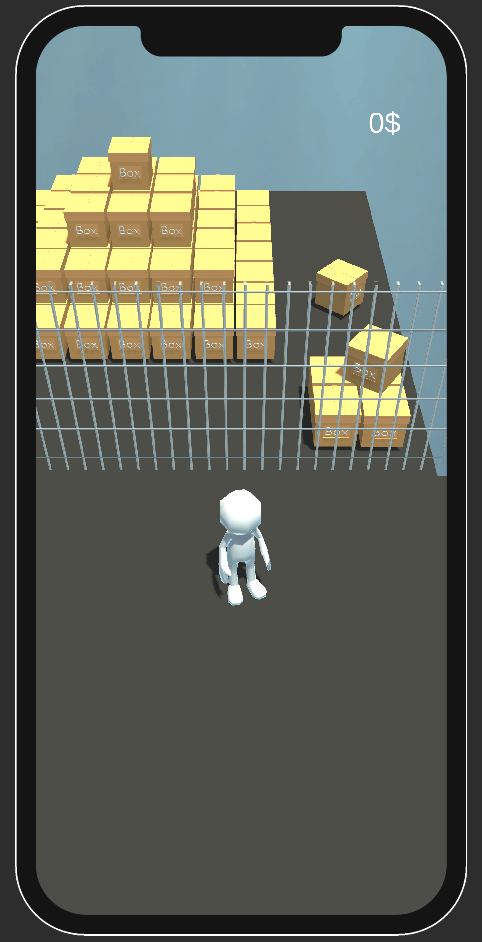
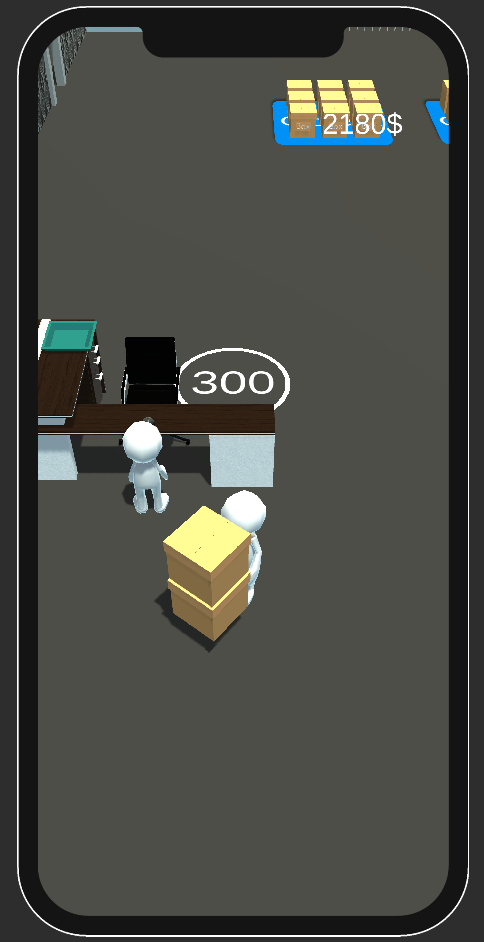
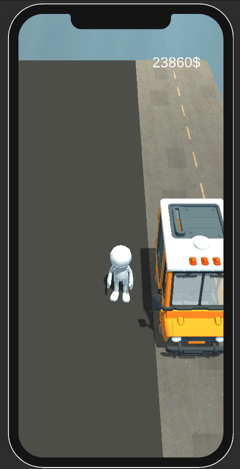
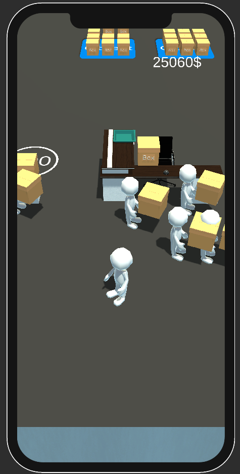
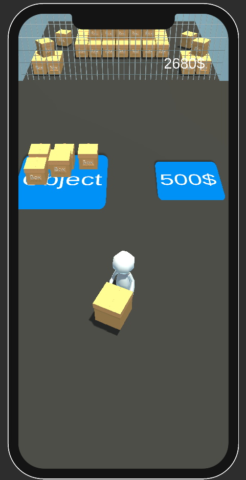
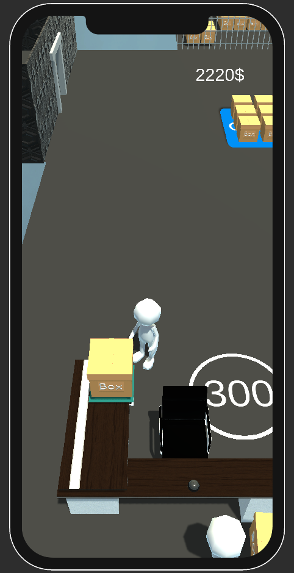

# PostOffice

Kargo dağıtarak para kazanılan ve postaneyi büyütülen bir arcade idle mobil oyun.

## Neden?

Idle oyunların temel döngüsünü, yani üret, taşı, sat, kazandığınla yeni bölüm aç döngüsünü; müşterileri, çalışanları ve kargo aracıyla birlikte kurmak için yapıldı.

## Oynanış

- Oyun 320$ ile başlıyor. Bu parayla ilk masa ve kargo bölümü açılıp kargo işi başlatılıyor.
- Oyuncu kargo bölümünden kargoları alıp masaya bırakıyor, müşteriler kargolarını masadan alıyor.
- Kargo teslim ettikçe kazanılan parayla postane büyütülüyor.
- Yeterli para varsa satın alma alanında durularak yeni bölüm açılıyor.
- Bütün masalar açılınca kargo aracı açılıyor. Araç sekiz kargo alıp şehre dağıtıma çıkıyor.

## Ekranlar

| Masa | Kargo aracı |
|---|---|
|  |  |
| **Müşteriler** | **Kargo bölümü** |
|  |  |
| **Kargo alma** | |
|  | |

## Teknik

| | |
|---|---|
| **Motor** | Unity |
| **Kullanılanlar** | NavMesh Agent, DOTween, joystick, olay sistemi, nesne havuzu |
| **Bu repoda** | Yalnızca oyunun scriptleri (`Assets/Codes`) ve ekran görüntüleri (`Images`); Unity projesinin tamamı yok |
| **GitHub'a yükleme** | Mart 2023 |
